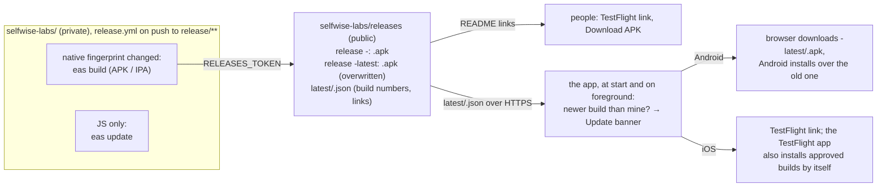

# App distribution: one public repo, and an Update button in every app

2026-10-28 · Status: decided

## Goal

Anyone gets Selfwise, Sagax or Sapor from one public URL on either platform, and an installed app
that is too old for the next over-the-air update tells its user so and takes them to the
download. The app repositories stay private.

## Pieces



### The public repo

- `README.md`: the landing page, one row per app with the TestFlight link and the APK link.
- Releases: per app, a versioned release `<app>-<name>` (for example `sapor-v9`) holding the APK
  of that native build, and a rolling release `<app>-latest` whose single asset `<app>.apk` is
  replaced on every native build, so the README link never changes. A repository-wide "latest"
  link would be ambiguous with three apps.
- `latest/<app>.json`, committed by the workflows:

  ```json
  {
    "android": { "build": 6, "release": "v9", "fingerprint": "<hash>", "url": "https://github.com/selfwise-labs/releases/releases/download/sapor-latest/sapor.apk" },
    "ios": { "build": 1, "release": "v9", "fingerprint": "<hash>", "url": "https://testflight.apple.com/join/mnCAbn61" }
  }
  ```

  `build` is the native build number EAS assigned (`appVersionSource: remote`, `autoIncrement`):
  Android `versionCode`, iOS `CFBundleVersion`. Each platform's section is written only when that
  platform was built, so an OTA-only release leaves the file untouched.
- No IPA: iPhones install only through TestFlight.

### The workflows

Each app's `release.yml` gains, after its Android build and after its iOS build, a step that
runs only when a build happened and `RELEASES_TOKEN` is set:

- Android: `gh release create <app>-<name>` in `selfwise-labs/releases` with the APK (notes: the
  fingerprint); `gh release create <app>-latest` if missing, then `gh release upload --clobber`
  the APK; then update `latest/<app>.json`'s `android` section.
- iOS: update the `ios` section (build number from the `eas build --json` output; the link is a
  constant per app).
- The JSON update: read the file through the contents API (`gh api`), merge the section with
  `jq`, write it back with the file's `sha`, up to three tries: two apps releasing at once commit
  to the same `main`, and the contents API answers 409 to the loser. Both steps keep the private
  repo's own GitHub Release and APK as today. A re-run skips the steps once the EAS build exists,
  so a failure after that is fixed by hand on GitHub.

`RELEASES_TOKEN` is a fine-grained personal access token: owner `selfwise-labs`, repository
`releases` only, permission Contents: read and write. Stored as an organization secret shared
with the three private repos, read by a gate step and passed only to the two publish steps
(not the job environment, where `npm ci` and `npx` could read it). Without it the publish
steps are skipped and the release is what it is today.

### The app

One module per app (`src/features/updates/`, same code in the three apps, as the pipeline is):

- `checkForUpdate(fetch, now)`: fetches
  `https://raw.githubusercontent.com/selfwise-labs/releases/main/latest/<app>.json`, reads the
  section for `Platform.OS`, compares `build` with the installed native build number
  (`expo-constants` `Constants.nativeBuildVersion`, parsed as an integer), and returns
  `{ build, url }` when the file's is higher, else `null`. Any error, a missing section or a
  non-numeric version returns `null`. Skipped in Expo Go and dev builds (`__DEV__`, or a null
  native build version).
- Runs at app start and when the app returns to the foreground, at most once every 6 hours
  (the last check's time kept in memory; a cold start checks again).
- `UpdateBanner`: a one-line banner on the main screen, "Version 7 available" with an Update
  button that opens the URL with `Linking.openURL`. Android: the browser downloads the APK and
  Android offers to install it. iOS: the TestFlight page of the app. Dismiss hides it until the
  next check that still finds a newer build.
- Nothing is forced: the app keeps working on the old build.

`Constants.nativeBuildVersion` is deprecated in favour of `expo-application` but present in SDK
57 and needs no new native module, so the checker ships over the air to the APKs installed
today; the first native release after that is the first one the banner announces.

### iOS and Beta App Review

Beta App Review is per version string (`1.0.0`), not per build: the first build of a version
needs the full review, later builds of the same version are approved automatically, usually
within minutes. The pipeline never changes the version string, so a new iOS build reaches the
external group without a reviewer. The TestFlight app installs approved builds by itself, so the
banner is a shortcut there. Until approval lands, the TestFlight page still shows the old build;
harmless.

## Testing

- The checker's comparison and error handling: unit tests with a fake `fetch` and a fixed
  installed version (newer, equal, older, missing section, network error, non-JSON).
- The banner: rendered in Expo Go with a forced result, then on Cristian's phone after the first
  release ships the module (no banner, since the build numbers match), then after the first
  native release following it (banner, Update opens the APK link, install over the old one).
- The workflows: the first native release of each app after the change creates the releases in
  the public repo and rewrites `latest/<app>.json`; an OTA-only release leaves them alone.

## Deliberately left out

| Left out | Why / what brings it back |
| --- | --- |
| A backend endpoint for the latest version | A static file in the public repo answers the same question with no code, no auth and no rate limit. Trigger: per-user rollout or private apps. |
| Forcing the update or blocking old builds | A tester on an old build loses only new features. Trigger: a backend change that old builds cannot talk to. |
| Checking App Store Connect for the approval of an iOS build before announcing it | Same-version builds are approved in minutes, and TestFlight shows the old build until then. |
| A GitHub Pages landing page | The README is the landing page. |
| Release notes in the banner or on the landing page | Trigger: someone asking what changed. |
| A shared npm package for the checker | Three copies of one small file, like the workflows. Trigger: a fourth app or a bug fixed twice. |
