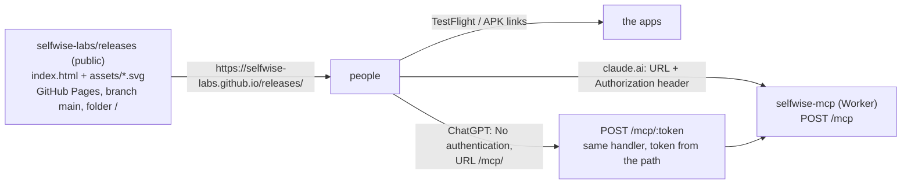

# Landing page, and a ChatGPT route to the MCP server

2026-10-28 · Status: decided (mockup approved: a Claude Design canvas, private)

2026-10-31: the connector section no longer uses tokens. Claude and ChatGPT sign in through the
MCP server's OAuth page (selfwise-mcp PR #26, `docs/2026-10-30-oauth-design.md` there); the
`/mcp/<token>` URL form below now answers the OAuth challenge instead. Codex still uses a token.

## Goal

One public page that Cristian shares with people he knows: what the three apps are, where to
get them, that online features are in beta behind an invite code, and how to connect Claude or
ChatGPT to their data. No contact address on the page; whoever has the link knows Cristian.

## Pieces

### The page

- One static file, `index.html` at the repository root, plus the three app marks as
  `assets/selfwise.svg`, `assets/sagax.svg`, `assets/sapor.svg` (copies of each app's
  `assets/brand/*-glyph.svg`), and `.nojekyll` so GitHub serves the files as they are. The
  Markdown docs under `docs/` stay what they are; Pages serves them too, which is harmless.
- Content, in order: header (the three marks as the wordmark, nav); hero; one card per app with
  its mark, a one-line tagline in the app's colour, three bullets, and the TestFlight and
  `<app>-latest` APK buttons; the install note; the beta band (invite code; "ask Cristian");
  the assistants section (steps 1 and 2 in the app, then one card for Claude with the connector
  URL and header plus a Claude Code fold-out, and one for ChatGPT with the token-in-URL form
  plus a Codex fold-out); example questions; footer with the releases list and the repo.
- Look: the cream of the app icons (`#fff6ec`) as the panel colour, a warm near-black for text
  and buttons, white cards, Manrope from Google Fonts. The app colours appear only in the marks
  and one tagline each. The page is fluid: the card grids become one column under 760 px.
- Hosted by GitHub Pages from `main`, folder `/`, enabled once through the API
  (`POST repos/selfwise-labs/releases/pages`). No build step, no custom domain.

### The ChatGPT route

ChatGPT's custom MCP connectors support OAuth or no authentication, with no field for a request
header, so the bearer token from the Account screen cannot be entered there. The Worker gains
`POST /mcp/:token`: the same handler as `/mcp`, with the token read from the path instead of
the `Authorization` header (a header, when present, wins). Everything downstream is unchanged:
the token is a backend session, revocable from the Account screen, and the KV cache is keyed by
its hash. The page tells people the URL is a secret.

## Testing

- Page: open the Pages URL on a phone and a desktop; every link resolves (two TestFlight pages,
  three APK downloads, the releases list); the fold-outs open; no horizontal scroll at 390 px.
- Worker: unit tests through the in-process MCP client (`test/mcpClient.ts`): a client with the
  token in the URL and no header lists tools; `GET /mcp/<token>` is 405; `/mcp/` with an empty
  token is 404; a header on `/mcp/<other>` is the one used.

## Deliberately left out

| Left out | Why / what brings it back |
| --- | --- |
| OAuth 2.1 on the Worker (the proper ChatGPT route, and no header step on claude.ai) | An authorization server, a sign-in page and dynamic client registration for a handful of people who know Cristian. Trigger: people outside that circle, or a client that supports neither headers nor URL tokens. |
| A contact address or invite request form | The page is handed over in person; an address on a public page collects spam. Trigger: sharing the link beyond people Cristian knows. |
| Screenshots of the apps | The marks carry the identity; screenshots go stale with every release. Trigger: a reader who could not tell what an app does from its card. |
| A custom domain | `selfwise-labs.github.io/releases` is a fine URL for a page handed over in person. Trigger: printing the URL or putting it in an app store listing. |
| Analytics | Nothing to decide from them yet. |
