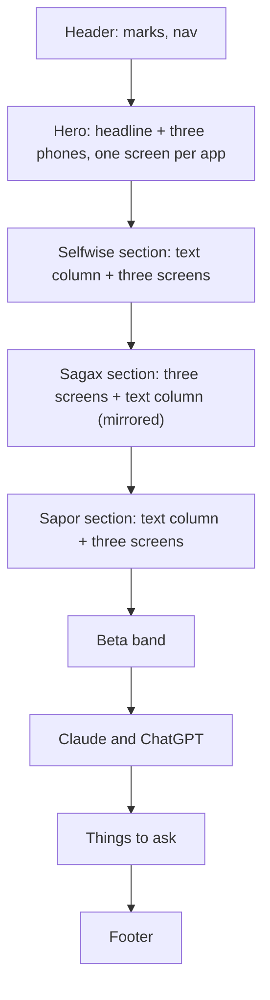

# Landing page: built around the screens

2026-10-29 · Status: decided (Cristian: "update the landing page with some in-app functionality
screenshots per app with dummy data ... feel free to redesign to fit this requirement, don't make
it patchy")

Supersedes the "Screenshots of the apps" line of `2026-10-28-landing-page-design.md`'s left-out
table: a reader could not tell from a card with three bullets what an app does, so the screens
become the body of the page. Everything else on that page (install notes, beta band, the
assistants section, example questions, footer) stays as it is.

## Page

Each app section is one band: the mark, name, tagline, one paragraph, three bullets and the two
Get buttons in a text column; beside it three phone frames, the middle one a step larger, each
with a one-line caption saying what the screen is. Sections alternate sides. Under 900 px the
phones become one horizontally scrolling, snap-aligned row under the text, so a phone reader
swipes through them. The hero shows the first screen of each app at a smaller size, overlapping
slightly, as the page's single picture of "three apps".

The phone frame is CSS (a dark rounded bezel, 11 px, radius 40 px) around the image, no device
artwork. Screens are real emulator captures, not mockups.

## Screens

| App | 1 | 2 | 3 |
| --- | --- | --- | --- |
| Selfwise | Journal, today: sleep block, morning routine, work, entries done and planned | Activities: levels, XP bars, streak multipliers | Analytics: XP over time per activity, today's levels |
| Sagax | Home: volume trend, exercises e1RM, running fitness, muscle load, workout cards with PR badges | Exercise screen of a live workout: sets with RIR, last time, rest timer | Plan: 5/3/1 cycle, training maxes, day cards |
| Sapor | Diary, yesterday: kcal and macros against targets, weight row, the meals | Nutrients: every macro, mineral and vitamin of the day against the reference intake | Weight: 7-day average, 1M chart, weekly groups |

## How the screens were made

- A demo account (`demo`) on the **local** backend (`selfwise-backend`, `wrangler dev`), never
  production. A Node script in the session scratchpad pushed rows in each app's own schema
  through `POST /sync/<app>/push`: 30 weeks of gym workouts and runs for Sagax, 4 weeks of days
  (routines, schedule, sleep, entries) for Selfwise, 10 days of meals and 45 weigh-ins for Sapor.
  The names are invented; the numbers are what a 30-something who trains four times a week
  would log.
- Android 15 emulator (`Pixel_API_35`, 1080×1920) started with `-timezone America/Los_Angeles`
  so the capture, made late in the evening in Romania, reads as mid-afternoon; gesture
  navigation and the system UI demo mode (full battery, Wi-Fi, no notifications); Expo Go SDK 57
  on each app's `main`, Metro pointed at the local backend with `EXPO_PUBLIC_API_URL`.
- Captures scaled to 540 px wide, the gesture bar cropped, saved as WebP under `assets/screens/`
  as `<app>-<screen>.webp` (9 files, 240 KB together).

## Deliberately left out

| Left out | Why / what brings it back |
| --- | --- |
| iOS captures | No simulator on Windows. The screens are identical in layout; the Android status bar is the only tell. Trigger: a reader asking whether it is an iPhone app. |
| A device photo or 3D frame | A plain bezel keeps the files small and the screens readable at phone width. |
| A dark theme for the page | The apps are light; one look. |
| Refreshing the captures with each release | They show what the apps do, not the current build. Trigger: a screen in them that no longer exists. |
