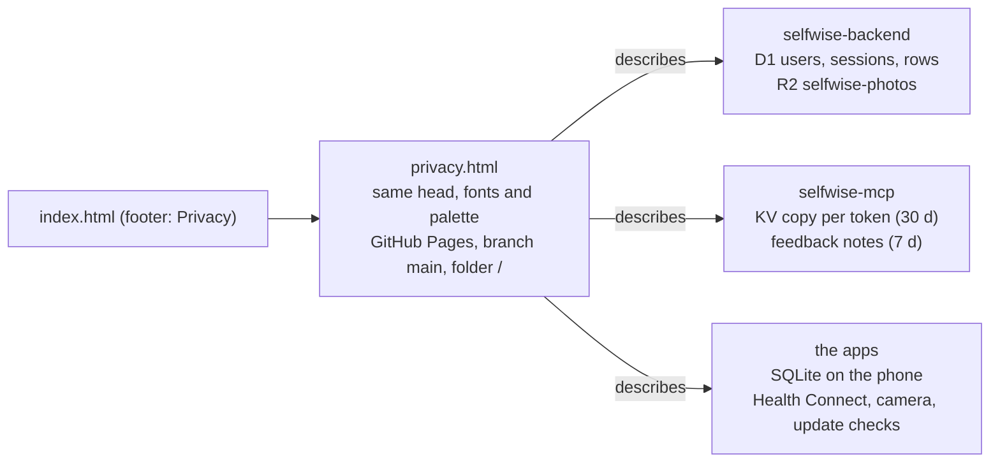

# Privacy policy page

2026-10-31 · Status: decided (board item "Privacy policy page", Selfwise Labs project)

## Goal

App Store Connect and Google Play both require a privacy policy URL. One static page next to the
landing page says what the apps and the server store, where, who can read it, and how to delete
it. Everything in it is taken from the code and the infrastructure inventory on 2026-10-31; it
describes what happens, not what a template says.

## Pieces

- `privacy.html` at the repository root, served at `https://selfwise-labs.github.io/releases/privacy.html`.
  Header and footer as on the landing page, a 760 px single column, a summary band, then sections:
  who runs this, on your phone, with an account (a table of what is stored and until when), where
  it is, if you connect Claude or ChatGPT, who can read it, deleting your data, changes.
- The landing page's footer gains a `Privacy` link. The policy's footer links back.
- Facts and their sources: schema `selfwise-backend/worker/migrations/*.sql` (username, PBKDF2
  hash, sessions with label and timestamps, rows with a deleted marker); `docs/2026-10-17-photos-design.md`
  (JPEG ≤ 2 MB, deleted on label); `cmt-agentic/infra/cloudflare.md` (D1, R2, KV TTLs, Workers
  Logs); the apps' `app.json` and `package.json` (Health Connect read permissions, no analytics or
  crash reporting, `u.expo.dev`), `src/features/updates/check.ts` (`raw.githubusercontent.com`).
- Contact: the way the reader got the invite code, or an issue in this repository. The landing
  page design keeps an email address off the page; the stores need a contact, and a public issue
  tracker is one.

## Testing

Open the page at 390 px and on a desktop: no horizontal scroll, the table collapses to stacked
rows on the phone, every link resolves (Home, the three nav anchors, Apple's TestFlight terms,
Cloudflare's privacy policy, the issues page, the file's history).

## Deliberately left out

| Left out | Why / what brings it back |
| --- | --- |
| A legal-template structure (controller, legal basis per purpose, DPO) | One person, a handful of invited users, no company. Trigger: a store review or a user asking for it, or the apps opening to the public. |
| A link to the policy inside the apps | The stores take the URL from the listing. Trigger: the Account screen gaining the Delete account button (board item 1), which is the natural place. |
| An email address | Kept off the page on purpose (landing page design). Trigger: a store rejecting the issues page as the contact. |
| Per-country data location | D1 and R2 do not expose a fixed region to promise. Trigger: a user asking. |
